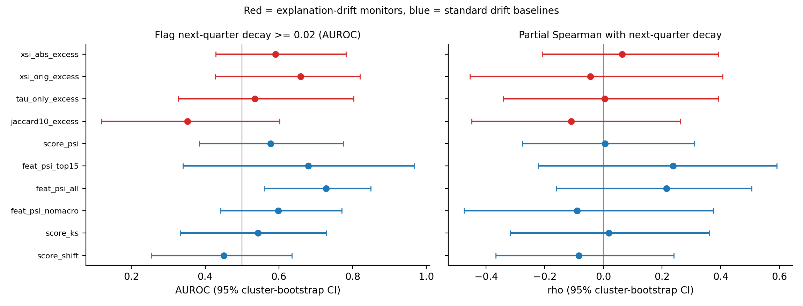

# XDrift: Temporal Stability of Explainable AI in Credit Risk Models

[](https://www.python.org/downloads/)
[](https://xgboost.readthedocs.io/)
[](LICENSE)
[](xdrift.ipynb)

## Abstract

Machine learning models deployed in high-stakes financial domains — such as consumer credit scoring — demand not only robust predictive performance but also **interpretable and stable explanations** over time. While model monitoring traditionally focuses on accuracy degradation under distribution shift (concept drift), the temporal stability of post-hoc explanations has received limited attention.

This project presents an empirical framework, **XDrift**, for evaluating explanation drift in credit default prediction models. It introduces the **Explanation Stability Index (XSI)**, a composite metric that quantifies how SHAP feature attributions evolve across rolling time windows, and **EART (Explanation-Aware Retraining Trigger)**, a proposed monitoring rule meant to fire on explanation drift *before* predictive performance (AUC) degrades. The repo then tests those ideas on real data with a pre-declared analysis — and reports where they do and do not hold (see [Findings](#findings)).

### Core Hypothesis (tested — see Findings)

> _Explanation stability (measured by XSI) degrades before predictive performance (measured by ROC-AUC) drops under natural temporal distribution shifts — and this effect is strongest during Bear/Crisis market regimes._

### XSI Formula

For consecutive rolling windows `t-1` and `t`, with SHAP attribution vectors `shap_t`:

```
XSI_t = 0.4 · Kendall_τ(rank_t, rank_{t-1})     # rank-order stability
      + 0.4 · CosineSim(shap_t, shap_{t-1})     # directional stability
      + 0.2 · (1 − PSI_shap(t, t-1))            # distribution stability
```

`XSI ∈ [0, 1]`; `XSI = 1` means explanations are identical to the previous window.

---

## Findings

Real LendingClub data (2007–2018, 1.35M resolved loans). Three studies, each with a **pre-declared analysis plan**
(hash-stamped into its results). Paper-style summary: **[WRITEUP.md](WRITEUP.md)** · details: [RESULTS.md](RESULTS.md) (v2),
[RESULTS_V3.md](RESULTS_V3.md) (v3) · interactive: `streamlit run app.py`.

**Bottom line: explanations do drift beyond retraining noise, but explanation drift is *not* a useful early-warning signal for
performance decay on this data, and it does not beat a standard score-PSI monitor.**

| Study | Question | Result |
|---|---|---|
| Base model | Is the credit model sound? | Test (2018) AUC **0.723**, Gini 0.446, KS 0.327 |
| v1 | Fixed-threshold EART, HMM regimes | Negative: XSI flat across regimes (p = 0.995), uncorrelated with AUC; the trigger fired on 85% of windows, so its "lead time" was an artefact |
| v2 | Does XSI drift exceed retraining noise? Rise with VIX? | Yes, drift exceeds the noise floor in **93%** of windows; rises with VIX only directionally (ρ = 0.43, p = 0.073, Holm 0.22) |
| v3 | Frozen models: does drift track/lead AUC decay? Beat score PSI? | **No.** P1 ρ = 0.08 [−0.15, 0.41]; P2 ρ = 0.06 [−0.21, 0.39]; P3 ΔAUROC vs score PSI = 0.013 [−0.16, 0.18] (all Holm-adj. p = 1.0) |

v3 uses 13 frozen models × 6 quarters (17 decay events) with model-swap permutation tests and cluster-bootstrap CIs. The intervals
are wide, so these are failures to find an effect rather than proof of none. Post-hoc: all decay events come from 5 late-2015
models, so decay here is largely a cohort effect.




---

## Methodology

1. **Phase 1 — Data pipeline & feature engineering.** Load LendingClub loan data, filter to resolved outcomes (Fully Paid vs. Charged Off/Default), engineer financial features, and merge quarterly macroeconomic context (Fed Funds Rate, VIX bucket).
2. **Phase 2 — Credit default model.** Train an XGBoost classifier (optionally Optuna-tuned) with `scale_pos_weight` for class imbalance.
3. **Phase 3 — XAI engine.** Generate global and local explanations with **TreeSHAP** (exact, non-sampled Shapley values) and **LIME** as a second-opinion comparator; compare their temporal stability.
4. **Phase 4 — XDrift framework (core novelty).**
   - Roll a fresh XGBoost + TreeSHAP fit across sequential time windows.
   - Compute **XSI** between consecutive windows.
   - Label each window's market regime (Bull / Neutral / Bear+Crisis) with a 3-state HMM over macroeconomic features.
   - Run **EART**: trigger a retraining alert when XSI drops below threshold, and compare its lead time against an AUC-degradation baseline trigger.
5. **Phase 5 — Results & figures.** Regime-stratified XSI/AUC summary table and the full set of paper figures (XSI timeline, XSI-by-regime violin plot, XSI component decomposition, EART vs. baseline trigger comparison, SHAP-vs-LIME agreement, AUC-vs-XSI scatter).
6. **Phase 6 — XDrift v2: calibrated, pre-declared analysis** (`xdrift_v2.py`, [ANALYSIS_PLAN.md](ANALYSIS_PLAN.md)).
   - **Noise floor:** 3 replicate models per window (80% subsample, different seed, independent eval draw) define how
     much XSI moves from retraining/sampling noise alone; *excess drift* = noise floor − observed XSI.
   - **Real market regimes:** CBOE VIX over each window replaces the HMM-on-default-rate regimes.
   - **Metric variants** (signed cosine, |SHAP|-profile cosine, Kendall τ only, top-10 Jaccard), all reported.
   - **Inference:** exact circular-shift permutation tests (windows overlap 75%), Holm correction on 3 primary tests,
     permutation null for the early-warning hit rate, bootstrap AUC intervals, relative (not fixed-level) degradation events.
   - Validated: reproduces the v1 XSI (r = 0.998) and ships unit tests (`test_xdrift_v2.py`).
7. **Phase 7 — XDrift v3: frozen-model monitoring** (`xdrift_v3.py`, [ANALYSIS_PLAN_V3.md](ANALYSIS_PLAN_V3.md)). 17 quarterly frozen models, six monitored
   quarters each; explanation drift vs. score/feature PSI and KS baselines for tracking and leading AUC decay, with model-swap permutation tests,
   cluster-bootstrap CIs, Holm correction, and sensitivity analyses.

## Dataset

| Dataset                   | Type                        | Years     | Source                                                                                               |
| -------------------------- | --------------------------- | --------- | ----------------------------------------------------------------------------------------------------|
| **LendingClub** (Primary) | Peer-to-peer personal loans | 2007–2018 | [Kaggle: wordsforthewise/lending-club](https://www.kaggle.com/datasets/wordsforthewise/lending-club) |

> **Note:** The dataset is not included in this repository due to size and licensing. See [Getting Started](#getting-started) below.

## Repository Structure

```
├── xdrift.ipynb       # Main notebook: full XDrift pipeline (Phases 1-5)
├── xdrift_v2.py        # v2: noise-floor-calibrated XSI, VIX regimes, permutation tests, figures
├── xdrift_v3.py        # v3: frozen-model monitoring vs. PSI/KS baselines, model-swap inference
├── test_xdrift_v2.py / test_xdrift_v3.py   # Unit tests for the statistics (14 tests)
├── ANALYSIS_PLAN.md / ANALYSIS_PLAN_V3.md  # Hypotheses/metrics/tests declared before each run
├── RESULTS.md / RESULTS_V3.md              # Generated results (primary tests, all variants)
├── WRITEUP.md          # Paper-style summary of all three studies
├── app.py              # Streamlit results explorer (reads the committed CSVs)
├── results_v1/         # Notebook run: per-window CSV + key figures
├── results_v2/         # v2 outputs: windows_v2.csv, secondary_tests.csv, figures/
├── results_v3/         # v3 outputs: panel_v3.csv, monitor tables, figures/
├── RUNBOOK.md          # How to run it (Kaggle/local), plus a log of bugs found & fixed
├── README.md           # This file
├── requirements.txt    # Python dependencies (local runs)
├── LICENSE             # MIT License
└── .gitignore          # Git ignore rules
```

## Getting Started

The notebook is built for Kaggle, where the dataset and most dependencies are pre-installed. See **[RUNBOOK.md](RUNBOOK.md)** for full step-by-step instructions (Kaggle and local), recommended smoke-test settings, and a log of real bugs that were found and fixed by execution.

Quick summary:

```bash
# Local setup
python -m venv venv
source venv/bin/activate        # Windows: venv\Scripts\activate
pip install -r requirements.txt
kaggle datasets download -d wordsforthewise/lending-club
unzip lending-club.zip -d data/
```

The notebook uses `data/accepted_2007_to_2018Q4.csv` locally by default. If your CSV lives elsewhere, set `XDRIFT_RAW_DATA` to its path before launching Jupyter, then run all cells. Start with a low `SHAP_SAMPLES_PER_WINDOW` and `N_OPTUNA_TRIALS = 0` for a smoke test before committing to the full run — see [RUNBOOK.md](RUNBOOK.md) for details.

### Reproducing v2

Run notebook cells 1–9 once (they write `train.parquet` / `test.parquet` to the working directory), download the
[CBOE VIX history](https://cdn.cboe.com/api/global/us_indices/daily_prices/VIX_History.csv) to `data/fred/VIXCLS_cboe.csv`, then:

```bash
python xdrift_v2.py all --data-dir working --vix data/fred/VIXCLS_cboe.csv --out results_v2 --v1 results_v1/xdrift_results.csv
python xdrift_v3.py all --data-dir working --out results_v3
python -m pytest
streamlit run app.py   # pip install -r requirements-app.txt
```

v2 takes ~15 minutes and v3 ~10 minutes (sharded across 3 processes) on a 20-core CPU; both resume if interrupted.

## Technical Stack

| Library                                                   | Purpose                                                    |
| ----------------------------------------------------------| ------------------------------------------------------------ |
| [XGBoost](https://xgboost.readthedocs.io/)                | Credit default model (`tree_method="hist"`)                |
| [SHAP](https://shap.readthedocs.io/)                      | TreeSHAP attributions — the core input to XSI              |
| [LIME](https://github.com/marcotcr/lime)                  | Second-opinion local explanations                           |
| [hmmlearn](https://hmmlearn.readthedocs.io/)               | 3-state HMM for market regime detection                    |
| [Optuna](https://optuna.org/)                              | Hyperparameter tuning for the XGBoost model                |
| [scikit-learn](https://scikit-learn.org/)                  | Evaluation metrics (ROC-AUC, KS, Gini) and preprocessing   |
| [SciPy](https://scipy.org/) / [scikit-posthocs](https://scikit-posthocs.readthedocs.io/) | Kendall τ, statistical post-hoc tests |
| [pandas](https://pandas.pydata.org/)                       | Data manipulation and rolling-window generation            |
| [matplotlib](https://matplotlib.org/) / [seaborn](https://seaborn.pydata.org/) | Paper figures                          |

## Practical Implications

XSI was proposed as a **monitoring metric** for deployed credit models. On LendingClub data it detects explanation change beyond retraining noise, but in the frozen-model study it neither tracked nor led performance decay and did not beat a standard score-PSI monitor (see Findings), so on this evidence it is best treated as a complementary audit signal for explanation stability, not as a proven early-warning trigger. Explanation monitoring is relevant to model-risk expectations under the **EU AI Act** (Article 9: Risk Management) and **SR 11-7** (OCC/Federal Reserve model risk management guidance).

## References

1. Lundberg, S. M., & Lee, S.-I. (2017). A Unified Approach to Interpreting Model Predictions. _NeurIPS_.
2. Ribeiro, M. T., Singh, S., & Guestrin, C. (2016). "Why Should I Trust You?": Explaining the Predictions of Any Classifier. _KDD_.
3. Lundberg, S. M., et al. (2020). From Local Explanations to Global Understanding with Explainable AI for Trees. _Nature Machine Intelligence_.

## License

This project is licensed under the MIT License — see the [LICENSE](LICENSE) file for details.
